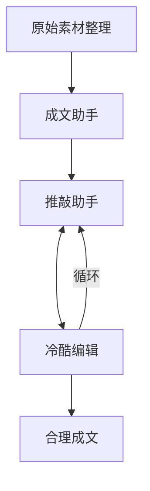

# 工作流程

0. 原始素材整理
1. 成文助手
2. 推敲助手
3. 冷酷编辑

在步骤2与步骤3之间循环，直至文本达到理想状态。每次调用相关技能后，需由我进行内容填充和判断。流程中应对需人工处理的部分进行明确标记，类似于 Git merge 的冲突标识。

---

成文助手应该能够调用下面几个子skill，甚至可以调用多个：
1.日常观察Skill:把普通生活写得有意味
2.事件复盘Skill:把经历写成一篇有层次的文章
3.观点随笔Skill:把一个想法写清楚
4.情绪整理 Skill:把混乱感受写得可阅读
5.读书/观影联想Skill:不是写书评，而是写"它碰到了我哪里”
6.人物记录Skill:写身边的人，而不是给人下定义

---

帮我构建workflow，我总是担心不能尽善尽美地完成skill的构建，然而skill的构建是一步步迭代的结果对吧。

few - shot

我有一系列文章，但是它们或许能够被归类为上面所说的文章分类。然后进行盲测验证

你应该像考试一样，不断给出测试文本，然后由我来打分，逐渐改进结果。

先蒸馏你已有的文字，再补充你想成为的风格，最后通过不断测试和修改，变成一个真正属于你的个人写作 skill。

至少我们应该逐渐合作，生成一个可用的版本。

我需要为此构建一个skill builder吗，大概我以后也许会构建其他的skill，如果迭代skill要用到，那我觉得有必要。

我后面肯定要总结很多up主的视频，势必也要复用build skill。当然我首先要解决的是怎么视频转文字。我观察到有一个女娲skill，不知道那个能否给出一些参考。

你觉得这件事我能在opencode中完成吗，我想它应该为了写代码，做了很多特调吧。